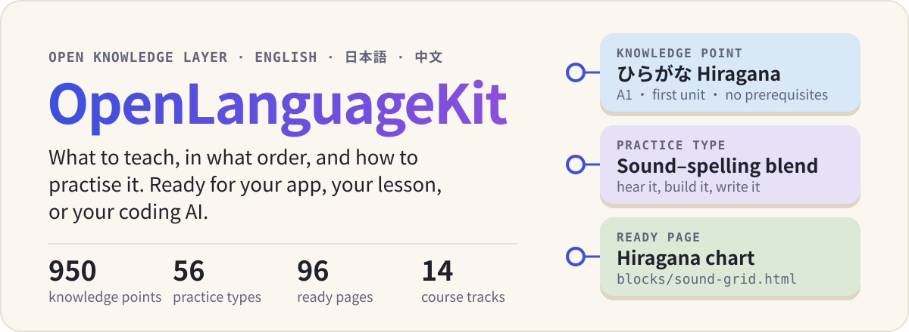
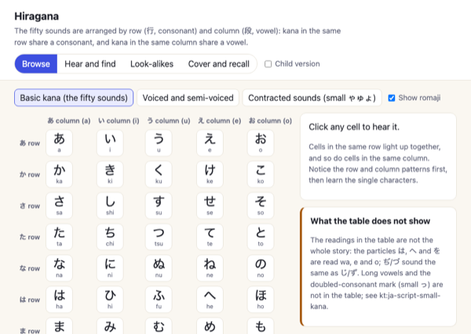
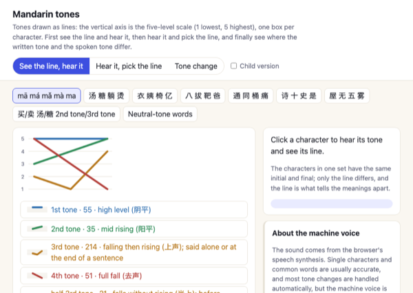
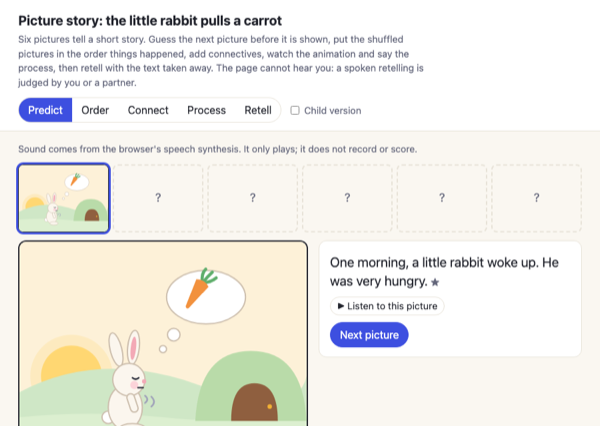
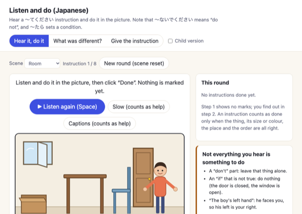
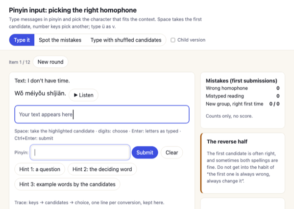
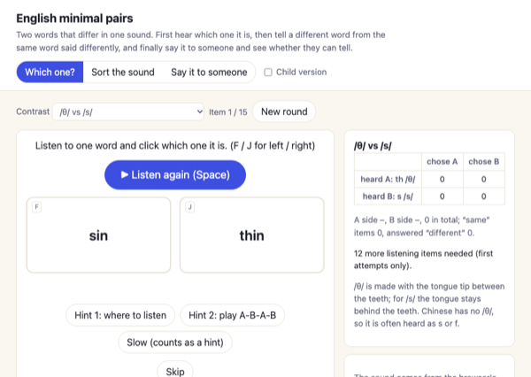
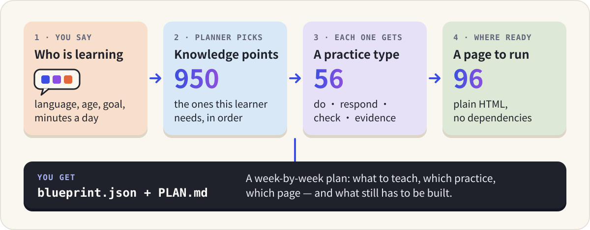

# OpenLanguageKit

<p align="center">
  
</p>

<p align="center">
  English · <a href="README.zh-CN.md">中文</a> &nbsp;|&nbsp;
  <a href="https://www.openlangkit.space"><b>Website</b></a> ·
  <a href="https://www.openlangkit.space/blocks/">Try the practice pages</a> ·
  <a href="https://www.openlangkit.space/curriculum/viewer/">Browse the courses</a> ·
  <a href="https://www.openlangkit.space/create/">Plan an app</a>
</p>

OpenLanguageKit is the part of a language-learning app that is hard to make up on the spot: **what to teach, in what order, and how each thing should be practised.** It covers English, Japanese and Chinese, and it is plain files (JSON, HTML, JavaScript) with no dependencies, so a person, a teacher or a coding AI can pick it up and build on it.

## Try a page

These are real pages from this repository. Click one to open it; nothing to install.

<table>
<tr><td width="33%" align="center"><a href="https://www.openlangkit.space/blocks/sound-grid.html?set=kana-hiragana&lang=en"></a><br><sub>Hiragana chart</sub></td><td width="33%" align="center"><a href="https://www.openlangkit.space/blocks/tone-contour.html?set=tones-zh&lang=en"></a><br><sub>Mandarin tones</sub></td><td width="33%" align="center"><a href="https://www.openlangkit.space/blocks/story-frames.html?set=story-en&lang=en"></a><br><sub>Story frames</sub></td></tr>
<tr><td width="33%" align="center"><a href="https://www.openlangkit.space/blocks/listen-and-do.html?set=listen-and-do-ja&lang=en"></a><br><sub>Listen and do (Japanese)</sub></td><td width="33%" align="center"><a href="https://www.openlangkit.space/blocks/ime-convert.html?set=ime-convert-zh&lang=en"></a><br><sub>Pinyin input: pick the right character</sub></td><td width="33%" align="center"><a href="https://www.openlangkit.space/blocks/sound-contrast.html?set=sound-contrast-en&lang=en"></a><br><sub>English minimal pairs</sub></td></tr>
</table>

All 96 pages are in the [gallery](https://www.openlangkit.space/blocks/).

## What you get

| | What it is | How many |
| --- | --- | --- |
| **Knowledge points** | One teachable thing each (hiragana, the past tense, the 把 sentence), with an explanation, examples, common errors, what mastery looks like, and what must be learned first | 950: English 353, Japanese 386, Chinese 211 |
| **Course tracks** | The same knowledge points selected and ordered for a kind of learner: a five-year-old starting English, an adult moving to Japan, a heritage child who speaks Chinese but cannot read it | 14 |
| **Practice types** | Design contracts for an activity: what the learner does, how the page responds, how it is checked, and what the result does and does not prove | 56 |
| **Practice pages** | Ready HTML pages built from those contracts, each tied to the knowledge points it practises | 96 pages from 30 engines |
| **Planner** | Turns "who is learning" into a week-by-week plan | browser, Node, command line |

## How it fits together

<p align="center">
  
</p>

## How to use it

Pick the line that sounds like you.

### 1. "I just want to look around" — no install

- [Browse the courses](https://www.openlangkit.space/curriculum/viewer/): every knowledge point, its prerequisites and its practice type.
- [Open the practice pages](https://www.openlangkit.space/blocks/).
- [Describe a learner and get a plan](https://www.openlangkit.space/create/), then download it.

### 2. "I want an AI to build me an app"

Clone the repository, open it in your coding AI (Claude Code, Codex, Cursor), and say what you want in one or two sentences:

```text
Read AGENTS.md and BLUEPRINT.en.md in this repository, then follow them.
I want a Japanese app for my 9-year-old who loves dinosaurs.
15 minutes a day, 5 days a week, on a tablet. She is starting from zero.
```

The AI asks for anything missing, runs the planner, and shows you a one-screen plan before it writes code. The look, the story and the game are its job; the course order and the checking rules come from here.

### 3. "I want the plan myself"

```sh
git clone https://github.com/ywEdAi/OpenLanguageKit.git
cd OpenLanguageKit
node blueprint/plan.js --list          # languages and tracks
node blueprint/plan.js --lang ja --track ja-hobby --age 8-12 --who child \
  --minutes 15 --days 5 --device tablet --out my-plan
```

This writes two files. `my-plan/PLAN.md` is for people: the weeks, what a session looks like, what already works. `my-plan/blueprint.json` is for programs: every knowledge point in order, its practice type, the page to use if there is one, and what still has to be built. Needs Node only. The command line currently prints in Chinese.

### 4. "I want to put a practice page in my own site"

Every page is a single HTML file that also works inside an iframe and reports what the learner did.

```html
<iframe id="block" src="blocks/sound-grid.html?set=kana-hiragana&lang=en" width="100%" height="680"></iframe>
<script>
  const frame = document.getElementById('block');
  window.addEventListener('message', e => {
    if (e.source !== frame.contentWindow || e.origin !== location.origin) return;
    if (e.data && e.data.source === 'kt-block' && e.data.kind === 'event') {
      console.log(e.data.event, e.data.summary);   // first attempts, correct alone, correct after a hint
    }
  });
</script>
```

To teach different content with the same engine, write a new data pack. The format is at the top of each file in `blocks/data/`; the rules are in [`blocks/README.en.md`](blocks/README.en.md).

### 5. "I only want the data"

| You want | Read |
| --- | --- |
| Knowledge points with everything attached | `curriculum/<en\|ja\|zh>/graph.json` |
| The order and the units | `curriculum/<lang>/path.json`, `tracks.json` |
| Which practice type fits which knowledge point | `curriculum/<lang>/primitive-map.json` |
| The 56 practice contracts | `curriculum/primitives/primitives.json` |
| Which page practises which knowledge point | `blocks/registry.js` |
| All of it in one browser file | `dist/data.js` (generated: run `sh check.sh` once) |

The field definitions are in [`curriculum/SCHEMA.en.md`](curriculum/SCHEMA.en.md).

## Where things are

| Directory | Contents | Start with |
| --- | --- | --- |
| `curriculum/<en\|ja\|zh>/` | Knowledge points, learning path, tracks, source units, bindings to practice types | `curriculum/SCHEMA.en.md` |
| `curriculum/primitives/` | The practice-type contracts (called pedagogical primitives in the files) | `curriculum/primitives/README.en.md` |
| `blocks/` | Practice pages, data packs, a small shared runtime, and `registry.js` | `blocks/README.en.md` |
| `blueprint/` | The planner and its command line | `BLUEPRINT.en.md` |
| `pedagogy/` | A learning-sciences graph that the planner cites as design rationale | `pedagogy/README.en.md` |

To change this repository, read `CLAUDE.md` and run `sh check.sh` before and after. It needs Python 3 and Node, nothing else.

## What to know before you rely on it

- **The explanations are written in Chinese.** Knowledge-point explanations, example glosses and practice contracts are in Chinese; the examples themselves are in the language being taught. The practice pages and the docs have English versions. An English edition of the course content is in progress.
- **The Japanese and Chinese content has not been reviewed by teachers yet.** The list is in `curriculum/REVIEW.md`, and each data pack has a `review` list for a native speaker.
- **Many pages do part of their contract, not all of it.** What each one leaves out is written down in `blocks/GAPS.md` (Chinese).
- **The pages do not listen or grade speech.** Sound is browser text-to-speech for playback. Anything the learner says aloud is judged by the learner or a partner, and recorded as such.
- **The planner selects and schedules; it does not measure.** Its timing numbers are stated assumptions and its placement questions are self-report.
- Some English practice types point to pages in another repository, `edu-ai-builders/language-learning-asset-library`, by id.

## Licence

[Creative Commons Attribution-NonCommercial 4.0 International](LICENSE) (CC BY-NC 4.0), for everything in this repository: data, docs and code.

- **Free** for personal, educational, research and other non-commercial use. Give credit: name OpenLanguageKit, link to this repository and to the licence, and say if you changed anything.
- **Commercial use needs a separate paid licence from the author.** That includes selling an app, course or service built on this material, or using it inside a for-profit product. Ask before you build: see [COMMERCIAL.md](COMMERCIAL.md).
- Third-party frameworks cited as sources (for example the British Council / EAQUALS Core Inventory and GF 0025-2021) belong to their owners; this licence covers only the original material written here.
