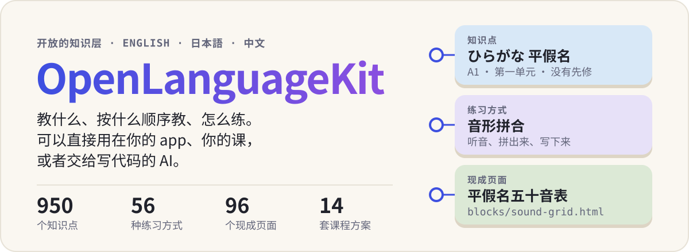
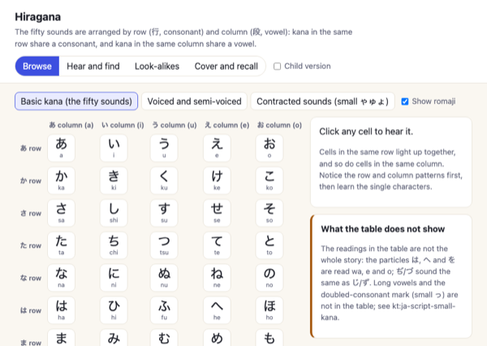
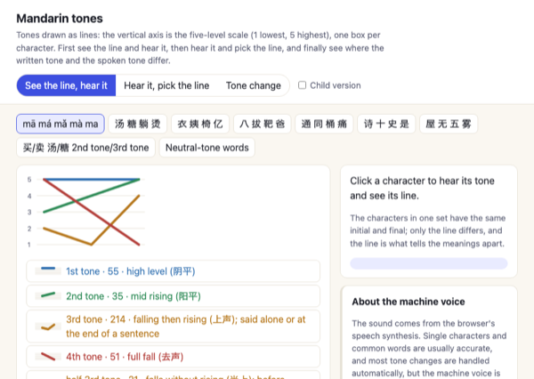
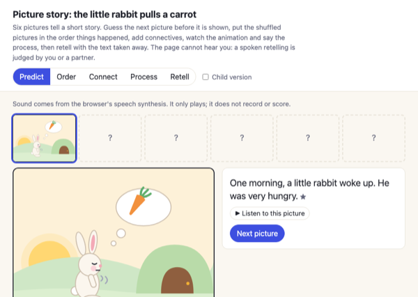
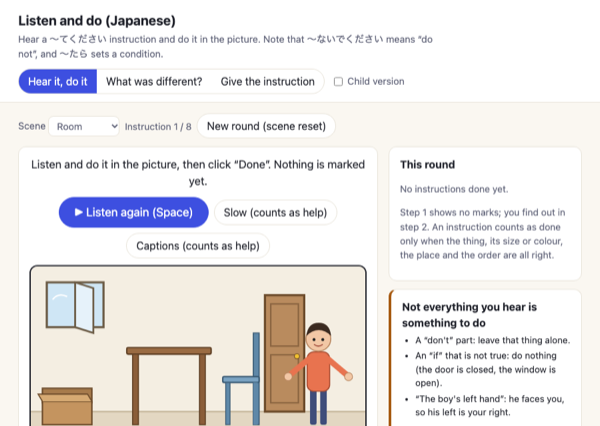
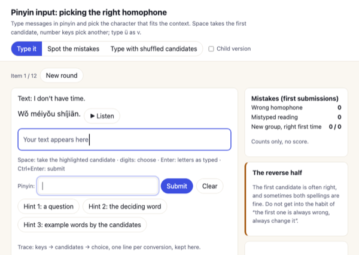
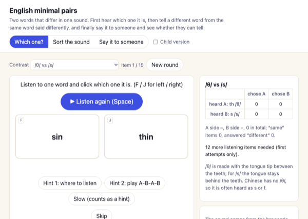
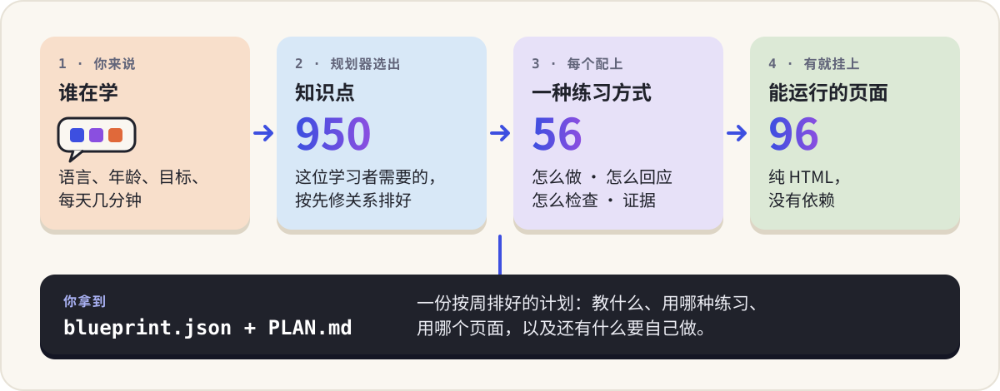

# OpenLanguageKit

<p align="center">
  
</p>

<p align="center">
  <a href="README.md">English</a> · 中文 &nbsp;|&nbsp;
  <a href="https://www.openlangkit.space"><b>网站</b></a> ·
  <a href="https://www.openlangkit.space/blocks/">试试练习页面</a> ·
  <a href="https://www.openlangkit.space/curriculum/viewer/">浏览课程</a> ·
  <a href="https://www.openlangkit.space/create/">规划一个 app</a>
</p>

做语言学习 app 时，最难临时编出来的是这一部分：**教什么、按什么顺序教、每样东西该怎么练。** OpenLanguageKit 把它整理好了，覆盖英语、日语和中文。全部是普通文件（JSON、HTML、JavaScript），没有依赖，人、老师、写代码的 AI 都可以直接拿去用。

## 先试一个页面

下面是这个仓库里真实的页面，点开就能用，不用安装。

<table>
<tr><td width="33%" align="center"><a href="https://www.openlangkit.space/blocks/sound-grid.html?set=kana-hiragana&lang=zh"></a><br><sub>平假名五十音表</sub></td><td width="33%" align="center"><a href="https://www.openlangkit.space/blocks/tone-contour.html?set=tones-zh&lang=zh"></a><br><sub>普通话声调</sub></td><td width="33%" align="center"><a href="https://www.openlangkit.space/blocks/story-frames.html?set=story-en&lang=zh"></a><br><sub>连环画复述</sub></td></tr>
<tr><td width="33%" align="center"><a href="https://www.openlangkit.space/blocks/listen-and-do.html?set=listen-and-do-ja&lang=zh"></a><br><sub>听指令做动作（日语）</sub></td><td width="33%" align="center"><a href="https://www.openlangkit.space/blocks/ime-convert.html?set=ime-convert-zh&lang=zh"></a><br><sub>拼音输入：选对同音字</sub></td><td width="33%" align="center"><a href="https://www.openlangkit.space/blocks/sound-contrast.html?set=sound-contrast-en&lang=zh"></a><br><sub>英语最小对立辨音</sub></td></tr>
</table>

全部 96 个页面在[展示页](https://www.openlangkit.space/blocks/)。

## 里面有什么

| | 是什么 | 数量 |
| --- | --- | --- |
| **知识点** | 一个可以教的东西（平假名、过去时、把字句），带讲解、例子、常见错误、怎样算掌握、要先学什么 | 950 个：英语 353，日语 386，中文 211 |
| **课程方案** | 同一批知识点，为某一类学习者选好、排好：五岁开始学英语的孩子、要去日本生活的成人、会说不会读的华裔孩子 | 14 套 |
| **练习方式** | 一种活动的设计契约：学习者做什么、页面怎样回应、怎么检查、结果能说明什么、不能说明什么 | 56 种 |
| **练习页面** | 按这些契约做好的 HTML 页面，每个都登记了它练的是哪些知识点 | 30 个引擎，96 个页面 |
| **规划器** | 把“谁在学”变成一份按周排好的计划 | 浏览器、Node、命令行都能跑 |

## 它们怎么连起来

<p align="center">
  
</p>

## 怎么用

看哪一句像你。

### 1. “我只想先看看”——不用安装

- [浏览课程](https://www.openlangkit.space/curriculum/viewer/)：每个知识点、它的先修关系和练习方式。
- [打开练习页面](https://www.openlangkit.space/blocks/)。
- [描述一位学习者，拿到一份计划](https://www.openlangkit.space/create/)，可以下载。

### 2. “我想让 AI 帮我做一个 app”

把仓库克隆下来，用写代码的 AI（Claude Code、Codex、Cursor）打开，用一两句话说你要什么：

```text
先读这个仓库里的 AGENTS.md 和 BLUEPRINT.md，然后照着做。
我想给 9 岁的女儿做一个日语 app，她喜欢恐龙。
每天 15 分钟，一周 5 天，用平板。她是零基础。
```

AI 会问清楚缺的信息，运行规划器，先给你看一页计划，你同意了再写代码。长什么样、讲什么故事、怎么玩由它发挥；课程顺序和检查规则来自这里。

### 3. “我想自己拿到计划”

```sh
git clone https://github.com/ywEdAi/OpenLanguageKit.git
cd OpenLanguageKit
node blueprint/plan.js --list          # 语言和课程方案
node blueprint/plan.js --lang ja --track ja-hobby --age 8-12 --who child \
  --minutes 15 --days 5 --device tablet --out my-plan
```

会写出两个文件。`my-plan/PLAN.md` 给人看：每周学什么、一次练习什么样、哪些现在就能用。`my-plan/blueprint.json` 给程序用：按顺序排好的每个知识点、它的练习方式、有现成页面就给出页面、还有什么要自己做。只需要 Node。

### 4. “我想把练习页面放进自己的网站”

每个页面是一个 HTML 文件，可以放进 iframe，并且会把学习者做了什么报告出来。

```html
<iframe id="block" src="blocks/sound-grid.html?set=kana-hiragana&lang=zh" width="100%" height="680"></iframe>
<script>
  const frame = document.getElementById('block');
  window.addEventListener('message', e => {
    if (e.source !== frame.contentWindow || e.origin !== location.origin) return;
    if (e.data && e.data.source === 'kt-block' && e.data.kind === 'event') {
      console.log(e.data.event, e.data.summary);   // 第一次作答、独立答对、看提示后答对
    }
  });
</script>
```

想用同一个引擎教别的内容，就写一个新的数据包。格式写在 `blocks/data/` 里每个文件的开头，规则在 [`blocks/README.md`](blocks/README.md)。

### 5. “我只要数据”

| 你要的 | 读这个 |
| --- | --- |
| 知识点和它的全部信息 | `curriculum/<en\|ja\|zh>/graph.json` |
| 顺序和单元 | `curriculum/<lang>/path.json`、`tracks.json` |
| 哪个知识点配哪种练习方式 | `curriculum/<lang>/primitive-map.json` |
| 56 份练习契约 | `curriculum/primitives/primitives.json` |
| 哪个页面练哪些知识点 | `blocks/registry.js` |
| 打包成一个浏览器文件 | `dist/data.js`（生成文件：先跑一次 `sh check.sh`） |

字段说明在 [`curriculum/SCHEMA.md`](curriculum/SCHEMA.md)。

## 东西在哪

| 目录 | 内容 | 入口 |
| --- | --- | --- |
| `curriculum/<en\|ja\|zh>/` | 知识点、学习路径、课程方案、来源单元、到练习方式的绑定 | `curriculum/SCHEMA.md` |
| `curriculum/primitives/` | 练习方式的契约（文件里叫“教学原语”） | `curriculum/primitives/README.md` |
| `blocks/` | 练习页面（文件里叫“教学积木”）、数据包、共用的运行时、`registry.js` | `blocks/README.md` |
| `blueprint/` | 规划器和命令行 | `BLUEPRINT.md` |
| `pedagogy/` | 学习科学图谱，规划器引用它作为设计依据 | `pedagogy/README.md` |

要改这个仓库，先读 `CLAUDE.md`，改之前和改之后各跑一次 `sh check.sh`。只需要 Python 3 和 Node。

## 用之前要知道的

- **讲解是用中文写的。** 知识点讲解、例句释义和练习契约是中文，例句本身是所学的语言。练习页面和文档有英文版；课程内容的英文版正在做。文档以中文为准，校验脚本读的是中文文件。
- **日语和中文内容还没有经过教师核对。** 清单在 `curriculum/REVIEW.md`，每个数据包里也有等母语者确认的 `review` 清单。
- **很多页面只做到契约的一部分。** 每个页面没做到什么，写在 `blocks/GAPS.md`。
- **页面不听、不给发音打分。** 声音是浏览器的语音合成，只用来播放。学习者开口说的内容由自己或同伴判断，并且照此记录。
- **规划器只负责选和排，不负责测。** 排课用的数字是写明的假设，定级问题是自我报告。
- 一部分英语练习方式指向另一个仓库 `edu-ai-builders/language-learning-asset-library` 里的页面，这里只按 id 引用。

## 许可

[Creative Commons Attribution-NonCommercial 4.0 International](LICENSE)（CC BY-NC 4.0），适用于本仓库的全部内容：数据、文档和代码。

- **免费**用于个人、教学、研究和其他非商业用途。请署名：写明 OpenLanguageKit，链接到本仓库和许可，并说明是否做了修改。
- **商业使用需要另外向作者购买许可。** 包括出售基于这些内容做的 app、课程或服务，或者把它用在营利产品里。动手之前先联系：见 [COMMERCIAL.md](COMMERCIAL.md)。
- 作为来源引用的第三方框架（例如 British Council / EAQUALS Core Inventory、GF 0025-2021）归各自的所有者；本许可只覆盖这里原创的内容。
